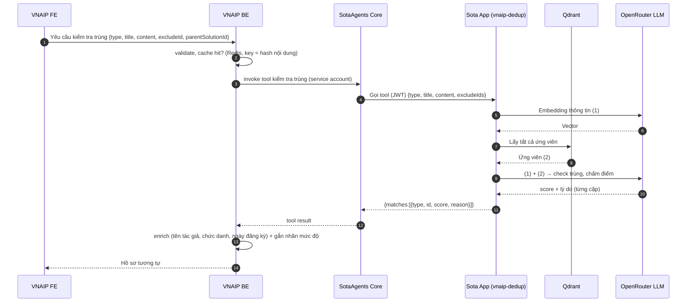
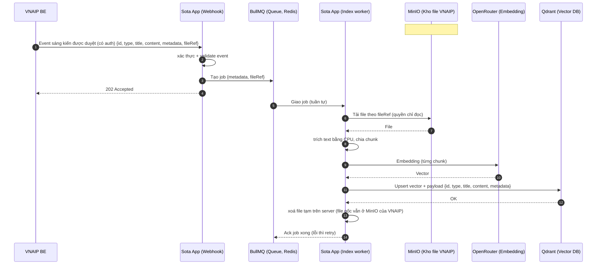

# Thiết kế hệ thống kiểm tra trùng ý tưởng (vnaip-dedup)

> Tài liệu tổng hợp từ các lần trao đổi và phản hồi của anh Hưng (Kai).
> Mục đích: mô tả kiến trúc, hai luồng chính, cơ chế xác thực, các quyết định đã chốt và các điểm còn mở.
> Cập nhật 2026-11-04: luồng 2 (index) được sửa theo diagram `Final1.png`. Queue là BullMQ (Redis); file đính kèm nằm trong MinIO của VNAIP và được tham chiếu bằng `fileRef`. Các chi tiết về MinIO để `#TODO` vì VNAIP chưa có MinIO. Cùng ngày: bỏ `datasetKey` (mọi sáng kiến nằm chung một tập dữ liệu), Redis tự host (`noeviction`, không bật AOF) và worker chạy ở tiến trình riêng.

## Mục lục

1. [Tổng quan](#1-tổng-quan)
2. [Thay đổi so với thiết kế cũ](#2-thay-đổi-so-với-thiết-kế-cũ)
3. [Các thành phần và vai trò](#3-các-thành-phần-và-vai-trò)
4. [Luồng 1: Kiểm tra trùng và chấm điểm](#4-luồng-1-kiểm-tra-trùng-và-chấm-điểm)
5. [Luồng 2: Index sáng kiến đã duyệt vào Qdrant](#5-luồng-2-index-sáng-kiến-đã-duyệt-vào-qdrant)
6. [So sánh hai luồng và các API của Sota App](#6-so-sánh-hai-luồng-và-các-api-của-sota-app)
7. [Xác thực (auth)](#7-xác-thực-auth)
8. [Embedding và LLM chấm điểm](#8-embedding-và-llm-chấm-điểm)
9. [Qdrant và payload](#9-qdrant-và-payload)
10. [Quyết định đã chốt và giả định](#10-quyết-định-đã-chốt-và-giả-định)
11. [Các điểm cần làm rõ](#11-các-điểm-cần-làm-rõ)
12. [Rủi ro và lưu ý thiết kế](#12-rủi-ro-và-lưu-ý-thiết-kế)
13. [Thuật ngữ](#13-thuật-ngữ)
14. [Câu hỏi gửi anh Hưng](#14-câu-hỏi-gửi-anh-hưng)

---

## 1. Tổng quan

Ứng dụng dùng để kiểm tra trùng "ý tưởng" (sáng kiến). Khi người dùng nhập một ý tưởng mới, hệ thống so sánh với các sáng kiến đã được phê duyệt, chấm điểm mức độ giống nhau và trả về danh sách hồ sơ tương tự.

Hệ thống gồm hai luồng:

| Luồng | Mục đích | Kiểu xử lý |
|---|---|---|
| Luồng 1: kiểm tra trùng | Nhận ý tưởng mới, so với dữ liệu trong Qdrant, LLM chấm điểm | Đồng bộ, người dùng chờ kết quả |
| Luồng 2: index | Đưa sáng kiến đã duyệt vào Qdrant để làm dữ liệu so sánh | Bất đồng bộ (webhook, BullMQ (Redis), worker nền) |

Hai luồng liên quan chặt chẽ: luồng 2 nạp dữ liệu, luồng 1 đọc dữ liệu đó. Thiếu luồng 2 thì Qdrant rỗng và luồng 1 không có gì để so sánh.

## 2. Thay đổi so với thiết kế cũ

| Hạng mục | Thiết kế cũ | Thiết kế mới |
|---|---|---|
| Nguồn ứng viên | Sota App gọi ngược VNAIP BE để lấy ~30 ứng viên (id, type, title, content rút gọn) | Sota App tự lấy ứng viên từ Qdrant, không lấy từ VNAIP BE nữa |
| Vector hoá | Không có | Sota App gọi embedding model (qua OpenRouter) |
| Kho dữ liệu | Dữ liệu nằm ở VNAIP BE | Qdrant lưu vector kèm payload |
| Chấm điểm | LLM chấm từng cặp, trả score và lý do | Giữ nguyên, nay gọi LLM qua OpenRouter |
| Luồng nạp dữ liệu | Không có | Mới: webhook, BullMQ (Redis), worker index, đọc file gốc từ MinIO của VNAIP (#TODO) |
| Kết quả trả về | `{matches:[{type, id, score, reason}]}` | Giữ nguyên |

## 3. Các thành phần và vai trò

| Thành phần | Vai trò |
|---|---|
| **VNAIP FE** | Giao diện người dùng, gửi yêu cầu kiểm tra trùng |
| **VNAIP BE** | Validate, cache (Redis, key = hash nội dung), gọi kiểm tra trùng, enrich kết quả (tên tác giả, chức danh, ngày đăng ký), gắn nhãn mức độ. Gửi event khi sáng kiến được duyệt |
| **SotaAgents Core** | Trung gian trong luồng kiểm tra trùng: nhận tool invocation từ BE (service account), gọi tool của Sota App (JWT) |
| **Sota App (vnaip-dedup)** | Vector hoá thông tin, kết nối Qdrant, gọi LLM chấm điểm, nhận webhook và chạy job index |
| **Qdrant** | Chỉ lưu vector và payload. Không tự quyết định gì |
| **OpenRouter** | Cổng gọi model: embedding model (tạo vector) và chat LLM (chấm điểm) |
| **Queue (BullMQ)** | Hàng đợi job index, chạy tuần tự, retry khi lỗi. Chạy trên Redis |
| **Redis (queue)** | Lưu job của BullMQ. Tự host, đặt `noeviction`, hiện không bật AOF (bật khi cần); tách khỏi Redis cache của BE |
| **Index worker** | Thuộc Sota App nhưng chạy ở tiến trình riêng (không chung với web), lấy job từ BullMQ, tải file từ MinIO theo `fileRef` (quyền chỉ đọc), trích text bằng CPU, chia chunk, embedding, upsert vào Qdrant, xoá file tạm trên server |
| **MinIO (kho file VNAIP)** | Kho file gốc của VNAIP (hệ thống hiện có), Sota App chỉ đọc. **#TODO**: VNAIP chưa có MinIO (endpoint, bucket, quyền đọc, định dạng `fileRef`) |
| **Redis** | Cache kết quả kiểm tra trùng ở BE |

## 4. Luồng 1: Kiểm tra trùng và chấm điểm

Trạng thái: **anh Hưng đã xác nhận luồng này ổn** ("luồng này ok với phần chấm điểm").

### 4.1 Sơ đồ



### 4.2 Các bước chi tiết

| # | Từ | Đến | Nội dung | Ghi chú |
|---|---|---|---|---|
| 1 | FE | BE | Yêu cầu kiểm tra trùng `{type, title, content, excludeId, parentSolutionId}` | `excludeId` dùng để loại chính hồ sơ đang kiểm tra |
| 2 | BE | BE | Validate, kiểm tra cache Redis (key = hash nội dung) | Cache hit thì có thể trả ngay, không đi tiếp |
| 3 | BE | Core | Invoke tool kiểm tra trùng | Xác thực bằng service account |
| 4 | Core | Sota App | Gọi tool `{type, title, content, excludeIds}` | Xác thực bằng JWT |
| 5 | Sota App | OpenRouter | Embedding thông tin (1) | Embedding model |
| 6 | OpenRouter | Sota App | Vector | |
| 7 | Sota App | Qdrant | Lấy tất cả ứng viên | Qdrant chỉ đóng vai trò nơi lưu vector |
| 8 | Qdrant | Sota App | Danh sách ứng viên (2) | Xem định nghĩa (1) và (2) bên dưới |
| 9 | Sota App | OpenRouter | Gửi (1) + (2) để check trùng và chấm điểm | Chat LLM |
| 10 | OpenRouter | Sota App | Score và lý do cho từng cặp | |
| 11 | Sota App | Core | `{matches:[{type, id, score, reason}]}` | |
| 12 | Core | BE | Tool result | |
| 13 | BE | BE | Enrich (tên tác giả, chức danh, ngày đăng ký) và gắn nhãn mức độ | |
| 14 | BE | FE | Danh sách hồ sơ tương tự | |

### 4.3 Định nghĩa (1) và (2)

- **(1)**: ý tưởng người dùng đang nhập, gồm `type`, `title`, `content`.
- **(2)**: danh sách các ý tưởng và hồ sơ đã tồn tại, lấy từ Qdrant. Mỗi ứng viên có `id`, `type`, `title` và nội dung (rút gọn hoặc đầy đủ).
- LLM so sánh (1) với từng ứng viên trong (2) theo cặp, rồi trả `score` và `reason`. Các ứng viên bị đánh giá là giống sẽ nằm trong `matches`.

### 4.3.1 Điểm còn treo ở bước embedding

Hiện luồng đang **lấy tất cả ứng viên**, nên vector của (1) ở bước 5 và 6 chưa được dùng để tìm kiếm. Có hai hướng:

| Hướng | Mô tả | Ưu điểm | Nhược điểm |
|---|---|---|---|
| A. Giữ lấy tất cả ứng viên | Bỏ bước embedding khỏi luồng 1 | Đơn giản | Chậm và tốn token LLM khi dữ liệu lớn |
| B. Tìm top-k theo vector | Giữ embedding, truy vấn Qdrant theo độ tương đồng | Đúng mục đích của vector DB, gửi ít ứng viên cho LLM | Phải chọn `k` và ngưỡng |

Cần chốt hướng này với anh Hưng (xem mục 11).

## 5. Luồng 2: Index sáng kiến đã duyệt vào Qdrant

Trạng thái: **anh Hưng đã đề xuất hướng làm**, một số chi tiết do tổng hợp thêm, xem mục 10.

### 5.1 Yêu cầu từ anh Hưng

- VNAIP BE gửi thông tin sáng kiến gồm: `id`, `type`, `title`, `content`, `metadata` và `fileRef` (tham chiếu tới file trong MinIO của VNAIP; BE không gửi file hay link).
- VNAIP BE **không** ghi thẳng vào Qdrant. Sota App tự tách nội dung và lưu vào Qdrant.
- Sota App expose **một webhook có auth** để BE gửi event vào khi sáng kiến được duyệt.
- Sota App tạo **một job** để index dữ liệu.
- Job dùng **một queue BullMQ (Redis)** để chạy tuần tự.
- Worker đọc file gốc từ MinIO của VNAIP bằng quyền chỉ đọc, trích text, rồi xoá file tạm trên server; file gốc vẫn nằm ở MinIO. **#TODO**: MinIO chưa có.

### 5.2 Sơ đồ



### 5.3 Các bước chi tiết

| # | Từ | Đến | Nội dung | Ghi chú |
|---|---|---|---|---|
| 1 | BE | Webhook | Event "sáng kiến được duyệt" kèm `{id, type, title, content, metadata, fileRef}` | Có xác thực. Không cần `datasetKey` (đã bỏ 2026-11-04) |
| 2 | Webhook | Webhook | Xác thực và validate event | Từ chối nếu auth sai hoặc dữ liệu thiếu |
| 3 | Webhook | BullMQ | Tạo job `{metadata, fileRef}` | Diagram ghi tắt; job còn cần `id, type, title, content` để upsert ở bước 11 |
| 4 | Webhook | BE | Trả `202 Accepted` | Trả ngay, không chờ index xong |
| 5 | BullMQ | Worker | Giao job, chạy tuần tự | |
| 6 | Worker | MinIO | Tải file theo `fileRef` (quyền chỉ đọc) | **#TODO**: MinIO của VNAIP chưa có |
| 7 | MinIO | Worker | File | **#TODO** |
| 8 | Worker | Worker | Trích text bằng CPU, chia chunk | Tốn CPU, nên worker chạy ở tiến trình riêng (đã tách khỏi web) |
| 9 | Worker | OpenRouter | Embedding từng chunk | |
| 10 | OpenRouter | Worker | Vector | |
| 11 | Worker | Qdrant | Upsert vector kèm payload `{id, type, title, content, metadata}` | Point ID xác định từ `id` sáng kiến và chỉ số chunk, nên retry không tạo trùng |
| 12 | Qdrant | Worker | OK | |
| 13 | Worker | Worker | Xoá file tạm trên server | File gốc vẫn ở MinIO của VNAIP |
| 14 | Worker | BullMQ | Ack job xong, lỗi thì retry | |

### 5.4 Vì sao webhook trả ngay và chạy nền

Tải file từ MinIO, trích text bằng CPU, embedding và ghi Qdrant đều chậm và có thể lỗi. Trả `202` sớm giúp BE không phải chờ và không cần biết chi tiết về Qdrant hay MinIO. Queue tuần tự giúp kiểm soát tải lên OpenRouter và Qdrant, và BullMQ lo việc retry.

## 6. So sánh hai luồng và các API của Sota App

Sota App có **hai endpoint thật**, nhưng chỉ **một** endpoint do VNAIP BE gọi trực tiếp.

| | Luồng kiểm tra trùng | Luồng index (webhook) |
|---|---|---|
| Ai gọi Sota App | SotaAgents Core (tool invocation, JWT) | VNAIP BE gọi trực tiếp |
| Đường đi | BE → Core → Sota App | BE → Sota App |
| Kiểu xử lý | Đồng bộ, BE chờ kết quả chấm điểm | Bất đồng bộ, trả `202` ngay, xử lý trong job |
| Dữ liệu vào | `{type, title, content, excludeIds}` | `{id, type, title, content, metadata, fileRef}` |
| Kết quả trả về | `{matches:[{type, id, score, reason}]}` | `202 Accepted`, kết quả index xử lý nền |

Nói "Sota App expose 2 API cho VNAIP BE" chỉ đúng một nửa vì luồng kiểm tra trùng đi qua SotaAgents Core. Nếu sau này BE gọi thẳng Sota App cho cả hai luồng thì SotaAgents Core có thể bị bỏ khỏi luồng kiểm tra trùng.

## 7. Xác thực (auth)

### 7.1 Hiện trạng

| Đoạn gọi | Cơ chế | Trạng thái |
|---|---|---|
| VNAIP BE → SotaAgents Core | Service account | Đã có trong thiết kế |
| SotaAgents Core → Sota App | JWT invocation | Đã có trong thiết kế |
| VNAIP BE → Sota App (webhook index) | HMAC-SHA256 kèm timestamp | Đã chốt phía app (2026-11-04), chờ BE triển khai ký. Xem `docs/ke-hoach-phat-trien.md` (quyết định #12) và `docs/webhook-vnaip-be.md` |

### 7.2 Webhook là gì

Webhook là một endpoint HTTP (thường là `POST`) do Sota App cung cấp, ví dụ `https://sota-app.example.com/webhooks/idea-approved`. Khi VNAIP BE có sự kiện (sáng kiến vừa được duyệt), BE chủ động gọi vào địa chỉ đó kèm dữ liệu. Khác với polling, Sota App không phải liên tục hỏi BE xem có gì mới.

"Expose" nghĩa là mở endpoint đó ra để bên ngoài gọi được. "Có auth" nghĩa là endpoint không để mở cho ai cũng gọi, vì nếu không người lạ có thể gửi event giả và làm bẩn dữ liệu trong Qdrant.

### 7.3 Các lựa chọn auth cho webhook

| Lựa chọn | Cách hoạt động | Ưu điểm | Nhược điểm |
|---|---|---|---|
| API key hoặc bearer token | BE gửi chuỗi bí mật trong header, Sota App so khớp | Đơn giản | Lộ key là dùng được, không bảo vệ toàn vẹn nội dung |
| JWT | BE gửi token có chữ ký, có hạn dùng | Đồng bộ với phần JWT đang dùng ở đoạn Core → Sota App | Cần quản lý khoá và vòng đời token |
| Chữ ký HMAC | BE ký nội dung event bằng secret chung, gửi chữ ký trong header, Sota App tính lại để kiểm tra | Đảm bảo nội dung không bị sửa trên đường đi | Cần thống nhất cách tạo chữ ký, tránh replay (thêm timestamp) |

Gợi ý: nếu muốn đồng nhất với hệ thống hiện tại thì dùng JWT. Nếu cần đảm bảo toàn vẹn nội dung thì dùng HMAC. Cuối cùng do anh Hưng quyết định. **Kết quả (2026-11-04): chọn HMAC kèm timestamp**, thêm chống replay bằng cách mỗi chữ ký chỉ nhận một lần.

## 8. Embedding và LLM chấm điểm

Hai loại model khác nhau, thường là hai lần gọi riêng:

| | Embedding model | Chat LLM |
|---|---|---|
| Việc làm | Biến text thành vector | Đọc (1) và (2), chấm điểm và nêu lý do |
| Ví dụ | `text-embedding-3-small`, `bge-m3` | Claude, GPT |
| Dùng ở | Luồng index (và luồng kiểm tra nếu tìm theo vector) | Luồng kiểm tra trùng |
| Đầu ra | Mảng số (vector) | Text hoặc JSON gồm score và reason |

Lưu ý quan trọng: model embedding dùng khi **query** phải trùng với model dùng khi **index**, nếu không vector không so sánh được với nhau.

Cả hai có thể cùng đi qua OpenRouter. Nếu embedding chạy ở nơi khác (model local, API khác) thì cần thêm một thành phần riêng trong diagram.

## 9. Qdrant và payload

Qdrant chỉ đóng vai trò nơi lưu vector. Để trả được danh sách ứng viên (2) cho LLM, mỗi point cần có payload:

```json
{
  "id": "<id sáng kiến>",
  "type": "<loại>",
  "title": "<tiêu đề>",
  "content": "<nội dung đầy đủ hoặc rút gọn>",
  "metadata": { }
}
```

Nếu payload chỉ có `id` thì Sota App phải lấy nội dung từ nguồn khác và luồng 1 cần thêm một bước.

Nếu một sáng kiến được chia thành nhiều chunk (nhiều point), cần gom lại theo `id` sáng kiến trước khi đưa cho LLM, nếu không (2) sẽ chứa nhiều bản ghi của cùng một sáng kiến.

## 10. Quyết định đã chốt và giả định

### 10.1 Đã chốt (theo anh Hưng)

- Luồng chấm điểm ổn.
- Thiếu luồng index dữ liệu từ các sáng kiến đã được phê duyệt.
- VNAIP BE gửi `title`, `content`, metadata và `fileRef` (tham chiếu file trong MinIO của VNAIP, cập nhật theo diagram `Final1.png`). Sota App lưu vào Qdrant.
- Sota App expose một webhook có auth để BE gửi event.
- Sota App tạo một job index, chạy tuần tự qua một queue BullMQ (Redis), theo diagram `Final1.png`.
- Sota App kết nối Qdrant, vector hoá, gọi LLM (OpenRouter) để chấm điểm.

### 10.2 Giả định (do tổng hợp, cần xác nhận)

- "Tách lưu vào qdrant" trong phản hồi (có vẻ gõ nhầm) hiểu là: tách nội dung (đọc file, chia chunk), embedding rồi lưu.
- Webhook trả `202 Accepted` rồi xử lý nền.
- Dùng `id` sáng kiến làm point ID để upsert không tạo bản ghi trùng.
- Payload Qdrant gồm `id`, `type`, `title`, `content`, `metadata`.
- Embedding và chat LLM cùng đi qua OpenRouter.

## 11. Các điểm cần làm rõ

| # | Câu hỏi | Tác động nếu khác hiện tại | Trạng thái |
|---|---|---|---|
| 1 | VNAIP BE vẫn gọi kiểm tra trùng qua SotaAgents Core, hay gọi thẳng Sota App? | Nếu gọi thẳng, bỏ Core khỏi luồng 1 và sửa diagram | Chưa xác nhận |
| 2 | Kiểu auth cho webhook index: JWT, API key hay HMAC? | Sota App phải chấp nhận hai kiểu auth, nên chốt cho thống nhất | Đã chốt HMAC kèm timestamp (2026-11-04); chờ BE triển khai ký, xem `docs/webhook-vnaip-be.md` |
| 3 | BE có cần nhận kết quả index về (callback trạng thái) không? | Nếu có, thêm callback khi job xong hoặc lỗi | Chưa xác nhận |
| 4 | Luồng kiểm tra trùng có còn cần embedding không (hướng A hay B ở mục 4.3.1)? | Quyết định giữ hay bỏ bước embedding và cách truy vấn Qdrant | Chưa xác nhận |
| 5 | Payload Qdrant lưu những trường nào? | Ảnh hưởng đến việc có cần bước lấy nội dung ở nguồn khác | Chưa xác nhận |
| 6 | Embedding model là gì và gọi qua đâu? | Có thể cần thêm thành phần vào diagram | Chưa xác nhận |
| 7 | Có chia chunk không, và gom lại theo `id` sáng kiến như thế nào? | Ảnh hưởng chất lượng (2) và số ứng viên gửi cho LLM | Chưa xác nhận |
| 8 | `fileRef` là gì (khoá object, bucket hay URL?) và MinIO của VNAIP có endpoint, bucket, quyền chỉ đọc nào? | Quyết định cách worker tải file | **#TODO**: VNAIP chưa có MinIO |
| 9 | Redis cho BullMQ chạy ở đâu? Có bật AOF và `noeviction` không? | Job chờ có thể mất khi Redis khởi động lại nếu không bền vững | Đã trả lời 2026-11-04: tự host, `noeviction`, không bật AOF (bật khi cần). Còn mở: có TLS không |
| 10 | Event trong diagram không có `datasetKey` (id workspace VNAIP): nó nằm trong `metadata` hay chỉ bị lược khi vẽ? | Thiếu thì không tách dữ liệu theo workspace được | Đã trả lời 2026-11-04: không cần `datasetKey`, mọi sáng kiến nằm chung một tập dữ liệu (xem `docs/ke-hoach-phat-trien.md`, mục 3.2) |

## 12. Rủi ro và lưu ý thiết kế

| Chủ đề | Lưu ý |
|---|---|
| Idempotency | BE có thể gửi lại event (retry). Point ID suy ra từ `id` sáng kiến và chỉ số chunk nên upsert không tạo bản ghi trùng. `id` phải duy nhất trong toàn VNAIP vì không còn tách theo workspace: hai sáng kiến trùng `id` sẽ ghi đè nhau |
| Cập nhật và xoá | Khi sáng kiến bị sửa, thu hồi hoặc huỷ duyệt thì cần event tương ứng để cập nhật hoặc xoá khỏi Qdrant. Hiện mới có event duyệt |
| Dữ liệu cũ | Các sáng kiến đã duyệt trước đây cần backfill vào Qdrant một lần |
| File đính kèm | **#TODO**: VNAIP chưa có MinIO. Khi có: worker đọc bằng quyền chỉ đọc; coi `fileRef` là khoá object hợp lệ chứ không phải URL tuỳ ý; giới hạn dung lượng; kiểm chữ ký file (PDF, DOCX); chặn zip bomb; trích text bằng CPU nên chạy ở tiến trình riêng; xoá file tạm trên server kể cả khi lỗi. Nếu không đọc được file thì chạy tiếp với `title` và `content` hoặc đánh dấu lỗi |
| Lỗi và retry | BullMQ thử lại với độ trễ tăng gấp đôi (mặc định 5 lần), sau đó job nằm ở tập `failed` của BullMQ (giữ 14 ngày). Còn cần quyết định có báo kết quả về BE hay không |
| Redis của queue | Phải đặt `noeviction`, tách khỏi Redis cache của BE. AOF đang tắt nên Redis khởi động lại là mất job đang chờ: BE cần gửi lại event chưa thấy được index (an toàn vì index idempotent). Job chứa nội dung sáng kiến nên Redis cần TLS hoặc nằm trong mạng nội bộ có truy cập hạn chế |
| Web và worker | Hai tiến trình riêng, phải dùng cùng `REDIS_URL`, `QUEUE_PREFIX`, `QUEUE_NAME`. Worker chết thì web vẫn trả 202 và job dồn lại trong Redis, nên cần cảnh báo độ sâu hàng đợi |
| Phạm vi dữ liệu | Không còn tách theo workspace nên ai gọi được tool `check-duplicates` là thấy mọi sáng kiến. Giới hạn người gọi bằng claims đã xác thực của Core (xem `docs/ke-hoach-phat-trien.md`, mục 3.2) |
| Độ trễ index | Sáng kiến vừa duyệt chưa chắc đã được index ngay, kiểm tra trùng trong khoảng này có thể bỏ sót. Queue tuần tự làm độ trễ tăng khi có nhiều event |
| Hiệu năng luồng 1 | Nếu lấy tất cả ứng viên, chi phí và độ trễ tăng theo số lượng sáng kiến. Cân nhắc hướng B (top-k) |
| Cache | Redis key = hash nội dung. Khi dữ liệu trong Qdrant đổi (có sáng kiến mới), kết quả cache cũ có thể không còn chính xác, cần chính sách hết hạn |
| Bảo mật webhook | Chống replay đã làm (timestamp ±5 phút và mỗi chữ ký chỉ nhận một lần, `replay-guard.ts`). Còn thiếu giới hạn tốc độ và chỉ nhận từ BE |

## 13. Thuật ngữ

| Thuật ngữ | Giải thích |
|---|---|
| Webhook | Endpoint HTTP do một hệ thống mở ra để hệ thống khác chủ động gọi khi có sự kiện |
| Expose | Mở một endpoint ra để bên ngoài gọi được |
| Service account | Tài khoản dùng cho hệ thống gọi hệ thống, không phải người dùng thật |
| JWT | Token có chữ ký số, mang thông tin xác thực và thời hạn |
| HMAC | Chữ ký tạo từ nội dung và secret chung, dùng để kiểm tra nội dung không bị sửa |
| Embedding | Biến text thành vector số để so sánh độ giống nhau |
| Vector DB (Qdrant) | Cơ sở dữ liệu lưu vector và hỗ trợ tìm kiếm theo độ tương đồng |
| Payload | Dữ liệu đi kèm mỗi vector trong Qdrant (id, title, content, ...) |
| Upsert | Thêm mới nếu chưa có, cập nhật nếu đã có |
| Chunk | Một đoạn nhỏ của văn bản dài sau khi chia để embedding |
| Top-k | Lấy k kết quả gần nhất theo độ tương đồng |
| Idempotent | Gọi nhiều lần cho cùng kết quả như gọi một lần |
| Dead-letter queue | Hàng đợi chứa các job lỗi sau nhiều lần retry |
| BullMQ | Thư viện hàng đợi job cho Node.js chạy trên Redis, có retry, trì hoãn và tập job lỗi (`failed`) |
| MinIO | Kho lưu file (object storage) tương thích S3 |
| 202 Accepted | Mã HTTP báo đã nhận yêu cầu, sẽ xử lý sau |

## 14. Câu hỏi gửi anh Hưng

> Anh ơi, em đang cố gắng hình dung rõ các luồng này để vẽ diagram cho hoàn chỉnh, có vài chỗ em chưa chắc nên muốn hỏi anh thêm ạ.
>
> Em có một thắc mắc chính: giữa VNAIP BE và Sota App sẽ xác thực với nhau bằng cách nào ạ?
>
> - Luồng chấm điểm: em đang hiểu là BE gọi qua SotaAgents Core bằng Service Account.
> - Luồng webhook index: em chưa rõ Sota App sẽ dùng cơ chế nào để xác thực request từ BE (ví dụ JWT, API key hay chữ ký HMAC). Anh định hướng giúp em với ạ.
>
> Em cảm ơn anh!

---

## Phụ lục: Các file liên quan

| File | Nội dung |
|---|---|
| `vnaip-dedup-sequence.html` và `.png` | Sequence diagram luồng kiểm tra trùng |
| `vnaip-index-sequence.html` và `.png` | Sequence diagram luồng index |
| `vnaip-sota-app-api.xlsx` | Bảng so sánh hai API và danh sách câu hỏi cần xác nhận |
| `Final1.png` (ngoài repo) | Diagram luồng index mới (BullMQ, MinIO); mục 5 của tài liệu này được cập nhật theo diagram đó |
